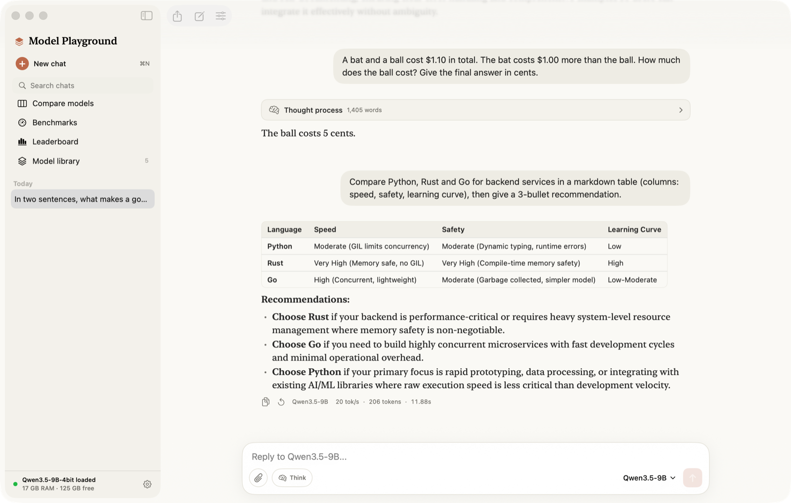

# Model Playground



A native macOS app for running, chatting with, comparing and benchmarking open-source LLMs locally on Apple Silicon.

- **Chat** in a Claude-style interface: streaming replies, Markdown with tables and code blocks, collapsible reasoning for thinking models, file and PDF attachments (drag and drop), system prompt presets, chat history with search, export to Markdown.
- **Design studio**: describe a product, pick a design system (style, brand color, font, radius) and generate matching pages (landing, pricing, dashboard, sign-in, mobile, email, components) on one canvas. Uses the WEBGEN design model when installed and saves every page as HTML. Chats also get a live HTML canvas.
- **Agents board**: one prompt, a grid of agents with their own roles, models and temperatures. Independent or chain mode, an optional synthesizer that merges the answers, and team presets (expert panel, code review, writers' room, debate, brainstorm, model shootout).
- **Compare** up to 4 models on one prompt: answers side by side, charts for speed, time to first token, output tokens, tokenizer efficiency, total time and memory, plus an **AI judge** that scores accuracy, helpfulness and clarity. **Blind mode** hides and shuffles names until you vote.
- **Benchmarks**: a 13-question auto-graded quiz (math, reasoning, knowledge, coding, instruction following, language) and a **long-context needle-in-a-haystack test** (1K to 64K tokens, 3 depths) with heatmaps and speed and memory vs context-length curves.
- **Leaderboard** across every chat, comparison and benchmark: speed, latency, judge quality, votes, quiz score and reliable context length.
- **Model library**: about 110 verified models from 0.3 GB to 450 GB (Qwen 3.5/3.6, Qwen3-Next, Gemma 4, Meta Muse Glimmer, Kimi K3 and Kimi Linear, Llama 3/4, DeepSeek R1/V3.1/V4, GLM 4.6, MiniMax M2, Mistral, Phi, gpt-oss and more), each with RAM fit estimates for your Mac, plus Hugging Face search, a choosable models folder and the Hugging Face cache. Full-precision models can be **downloaded and converted to 4-bit MLX** in one click, for example the Kimi K3-distilled Qwen3.5-9B.
- **Two engines**: [mlx-lm](https://github.com/ml-explore/mlx-lm) (fast, most architectures) and [AirLLM](https://github.com/lyogavin/airllm) (streams full-precision Llama models from disk, so models larger than RAM can run slowly; prompts are capped at 512 tokens). Switch engines per chat with the MLX / AirLLM toggle in the message box, or set a default engine in Settings.
- **Long context controls**: 8-bit or 4-bit KV cache quantization, or a sliding context window.

## Requirements

- Apple Silicon Mac, macOS 14 or later
- Swift toolchain (Xcode or the Command Line Tools)
- Python 3.10+ with `mlx-lm airllm fastapi uvicorn psutil`. The app can create this environment for you with one click on first launch.

## Build and run

```bash
./build.sh
open "build/Model Playground.app"
```

## Tests

See **[docs/TEST_RESULTS.md](docs/TEST_RESULTS.md)** for the latest results, a Qwen3.5-9B vs Qwen3-4B benchmark on a 16 GB Mac, bugs found during testing, and screenshots of every screen.

```bash
./scripts/run_tests.sh
```

To test one model end to end inside the app (chat, reasoning, document Q&A, benchmarks to 32K tokens and a judged head-to-head):

```bash
MP_TEST_MODEL=Qwen3.5-9B "build/Model Playground.app/Contents/MacOS/ModelPlayground" --selftest
```

`./scripts/run_tests.sh` runs `tests/test_backend_e2e.py` (33 checks against a real server and real models) and the app's `--selftest` mode (37 checks that drive the real app logic: chat, attachments, regenerate, stop, compare, tokenizer counts, judge, blind mode, benchmarks, leaderboard, persistence). It also renders a screenshot of every screen to `build/snapshots`.

## Layout

| Path | What it is |
|---|---|
| `App/` | SwiftUI app (Swift Package) |
| `backend/server.py` | Local FastAPI engine: model discovery, downloads, streaming chat, judge, benchmarks, tokenizer counts |
| `tests/` | Backend end-to-end test |
| `scripts/` | Test runner and icon generator |

The engine listens only on `127.0.0.1`, on a free port chosen at launch. Chats, run history and benchmark results are stored in `~/Library/Application Support/ModelPlayground`.

## Memory guide

macOS lets the GPU use roughly two thirds of unified memory. On a 16 GB Mac, 4-bit models up to about 8 GB (14B parameters) fit; for long chats, prefer 7–9B models with a quantized KV cache. The library marks larger models with the Mac memory size they need.
