# Test results

Run on October 02, 2026 on an Apple Silicon Mac with 16 GB of unified memory (macOS 26.7), Python 3.14, mlx-lm 0.32, AirLLM 4.0.

| Suite | Result |
|---|---|
| Backend end-to-end (`tests/test_backend_e2e.py`) | **33/33 passed** |
| App self-test (`ModelPlayground --selftest`) | **37/37 passed** (Design Studio checks are opt-in with `MP_DESIGN=1`) |
| Qwen3.5-9B in-app model test (`MP_TEST_MODEL=Qwen3.5-9B`) | **9/9 passed**, plus benchmarks below |
| Speed test (`MP_PERF=1`) | worst stall 61 ms (was 815 ms), p95 lag 9 ms (was 42 ms) |
| Kimi K3-distilled 9B in-app model test | **9/9 passed**, plus benchmarks below |

Run everything with `./scripts/run_tests.sh`.

## Qwen3.5-9B on a 16 GB Mac

| | Qwen3.5-9B (4-bit, 6 GB) | Qwen3-4B-2507 (4-bit, 2.3 GB) |
|---|---|---|
| Generation speed | ~20 tok/s | ~38–52 tok/s |
| Quiz (13 auto-graded questions) | **11/13** (missed: siblings riddle, "exactly three words") | 10/13 (missed: 17×23, siblings riddle, three words) |
| Long-context retrieval, 1K–32K tokens × 3 depths | **18/18** | 18/18 |
| Prompt processing at 32K tokens | 115 tok/s (~4.7 min per 32K prompt) | 125 tok/s |
| Peak memory at 32K tokens | 9.6 GB | 9.6 GB |
| Bat-and-ball riddle with thinking | Correct (5 cents) after 1,405 words of reasoning | not tested |
| 5.5K-token document Q&A, 8-bit KV cache | Correct (found the technician and date) | not tested |

Takeaways: Qwen3.5-9B is the strongest model tested on this Mac and handled every long-context test up to 32K tokens. It is about 2.5× slower than Qwen3-4B, which is nearly as reliable on retrieval. Long prompts are bounded by prompt processing speed (about 115–150 tok/s), not by context window size.

## Kimi K3 on a 16 GB Mac: the distilled 9B

Kimi K3 itself is 1.56 TB (the smallest MLX build is 181 GB), so it cannot run on a 16 GB Mac. The closest model that does is
[`khazarai/Qwen3.5-9B-Kimi-k3-Distilled`](https://huggingface.co/khazarai/Qwen3.5-9B-Kimi-k3-Distilled) (Apache-2.0): Qwen3.5-9B fine-tuned
on Kimi K3 coding and debugging traces. It is only published at full precision (19.3 GB), so the app downloads it and converts it
to 4-bit MLX (4.7 GB) with the new **Download & convert** feature. Conversion peaked at 12 GB of memory.

| | Kimi K3-distilled 9B | Qwen3.5-9B (its base) |
|---|---|---|
| Quiz (13 auto-graded) | **12/13** (missed: siblings riddle) | 11/13 (missed: siblings riddle, three words) |
| Long-context retrieval, 1K–16K × 3 depths | 15/15 | 15/15 |
| Generation speed | ~21–23 tok/s | ~20–22 tok/s |
| Bat-and-ball riddle with thinking | Correct after **90–180 words** of reasoning | Correct after 1,405 words |
| 5.5K-token document Q&A | Correct | Correct |
| AI judge head-to-head (index explanation) | 10/10 | 10/10 |

Takeaway: on these tests the distilled model is at least as good as its base, and its reasoning is roughly 6–10× shorter, so
thinking-mode answers arrive much sooner. Its tokenizer triggers a transformers warning about an "incorrect regex pattern"; we
verified the split pattern, vocabulary and token IDs are identical to the official Qwen3.5 tokenizer, so it is a false positive.
It is a small community fine-tune, so treat these results as indicative rather than definitive.

| | Check | Detail |
|---|---|---|
| ✅ | engine starts |  |
| ✅ | model is installed | Qwen3.5-9B-Kimi-k3-Distilled-mlx-4bit, 5.06 GB, 256K context |
| ✅ | chat | no thinking)  (21.1 tok/s, 58 tokens, 2.04s first token, 5.2 GB \| A good API design prioritizes simplicity and consistency by exposing only the functionality u |
| ✅ | reasoning is folded into a thought block | thought 102 words |
| ✅ | reasoning reaches a correct final answer | 21.1 tok/s, 285 tokens, 0.91s first token, 5.5 GB \| 5 cents.  Let b be the ball's cost in dollars. The bat costs b + 1.00, and together they cost 1.10, so 2b + |
| ✅ | markdown table answer | 21.1 tok/s, 197 tokens, 1.86s first token, 5.7 GB \| \| Language \| Speed \| Safety \| Learning Curve \| \| :--- \| :--- \| :--- \| :--- \| \| **Rust** \| Very  |
| ✅ | long document Q&A | 8-bit KV cache)  (prompt 5459 tokens · 20.3 tok/s, 31 tokens, 41.30s first token, 7.0 GB \| Based on the note provided in the file:  *   **Technician:** Mara Ok |
| ✅ | compare Qwen3.5-9B-Kimi-k3-Distilled-mlx is answered and judged | 21.9 tok/s, 160 tokens, judge 10.0/10 · The answer is an excellent, accurate, and clear explanation that fully meets the prompt's requirements. |
| ✅ | compare Qwen3.5-9B is answered and judged | 21.8 tok/s, 151 tokens, judge 10.0/10 · The answer is accurate, helpful, clear, and meets the word limit. |

Benchmarks (16K run):

| | Check | Detail |
|---|---|---|
| ✅ | benchmark Kimi K3-distilled 9B | quiz 12/13, context 15/15, reliable to 16K, peak 8.0 GB |
| ✅ | benchmark Qwen3.5-9B | quiz 11/13, context 15/15, reliable to 16K, peak 8.0 GB |

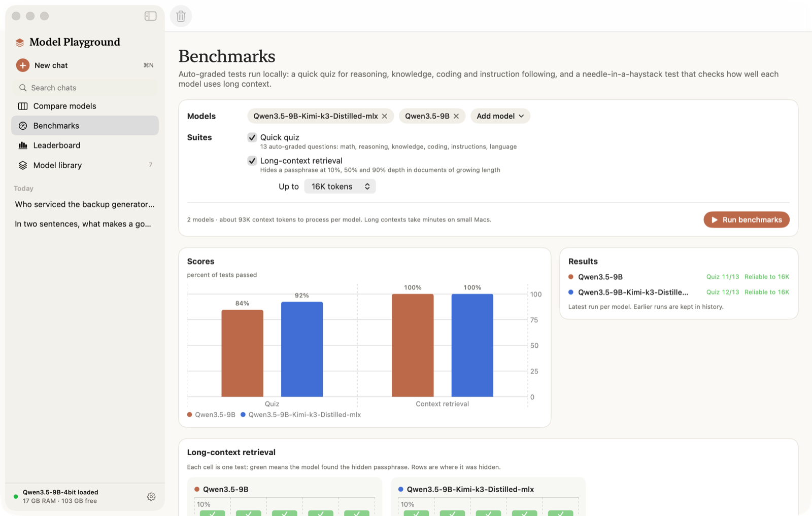

## Speed

Measured by `MP_PERF=1 ModelPlayground --selftest`: a 500-token reply streams into a chat with 20 rich Markdown messages while a
10 ms timer records how late the main thread runs (that lateness is what you feel as typing lag).

| | Before | After |
|---|---|---|
| 95th-percentile main-thread lag | 42 ms | **6 ms** |
| Stalls over 50 ms | 57 | **5** |
| Worst stall | 815 ms | **61 ms** |
| Main thread busy | 30% | 17% |
| Follow-up reply, first token (2.4K-token chat) | 1.15 s | **0.07 s** |

What changed: reply prose is drawn by AppKit's native text view (fast layout, and selection across paragraphs); Markdown regexes are compiled once and parsed results are cached; finished messages no longer re-render while a
reply streams; the message box keeps its text locally; streaming updates slow down as a reply grows; the engine reuses the
conversation's KV cache between turns and preloads models when a chat opens; MLX's spare buffer cache is capped at 512 MB.
Real-data diagnosis (`MP_DIAG=1`, read-only on the user's own chats) showed the app's main thread busy only about 85 ms per screen switch; longer pauses happened while the app was idle and waiting for the CPU, because the Mac was swapping heavily. The engine now frees the model after 5 idle minutes (configurable) and skips preloading when memory is short. The remaining occasional stalls coincided with heavy swapping (25 GB swap in use during testing); the sidebar now warns when
memory is low.

## Best model for design

[WEBGEN-4B-Preview](https://huggingface.co/Tesslate/WEBGEN-4B-Preview) (Tesslate, Apache-2.0, a Qwen3-4B fine-tune for websites)
is the design model the Design Studio picks by default. A 6-bit MLX build is 3.3 GB. On this Mac it wrote a full landing page
(5,145 tokens, about 8 minutes) and a pricing page that share one design system (brand color, Inter, 16 px radius):

| Landing page | Pricing page |
|---|---|
| 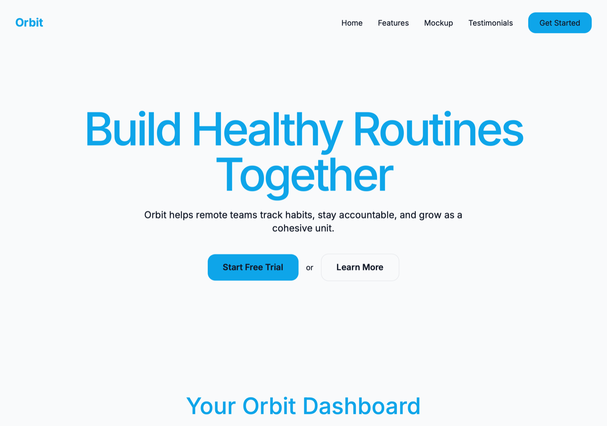 | 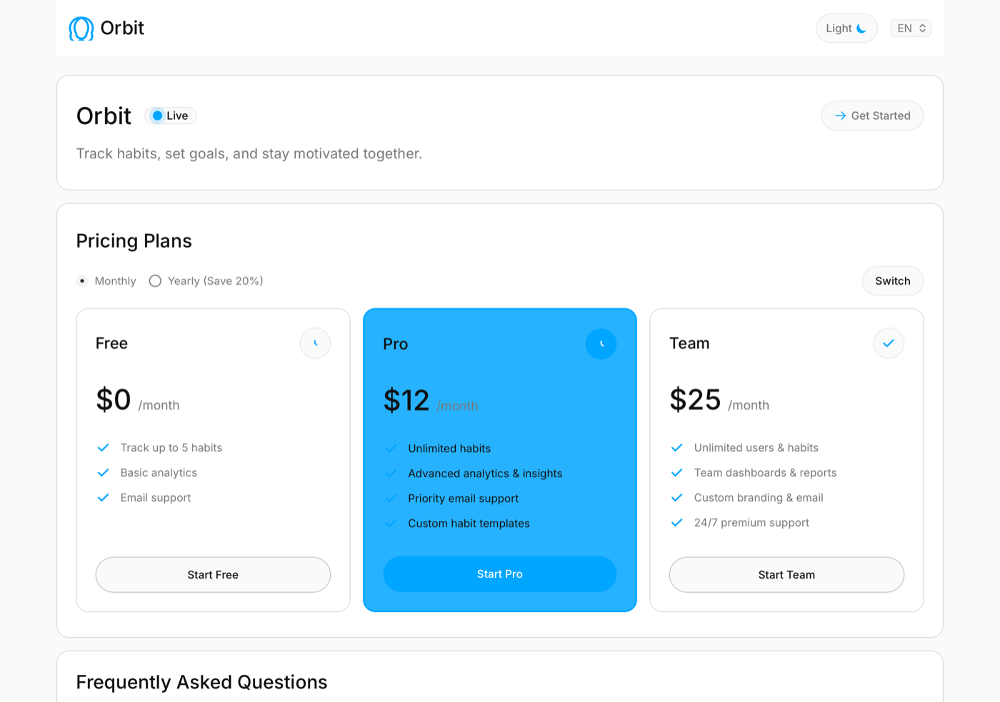 |

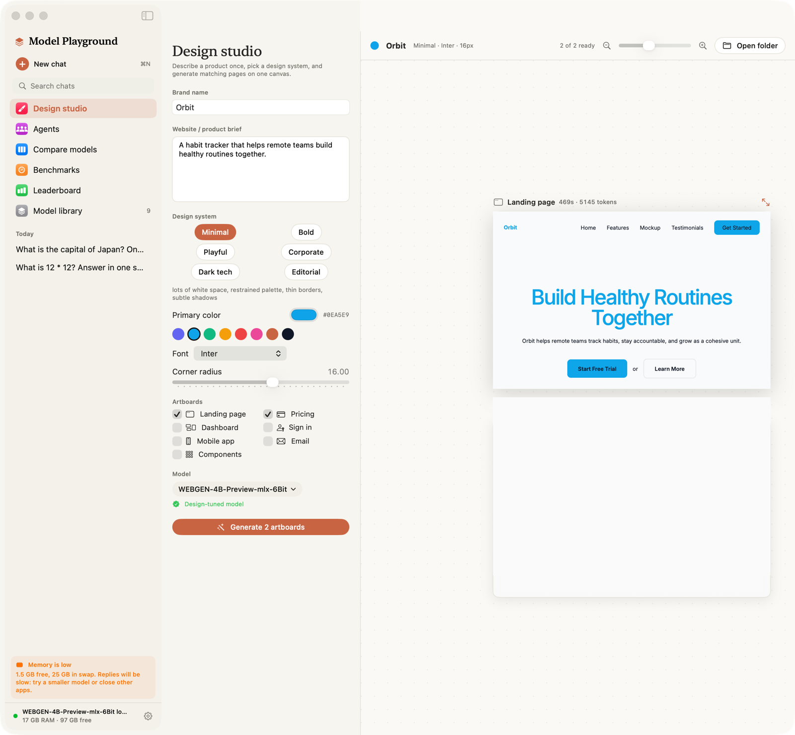

## Agents board

One prompt, a team of agents in a grid. Each agent has its own role, model and temperature. **Independent** mode runs every agent on the prompt
(agents sharing a model run back to back so it loads once); **Chain** mode lets each agent read and build on the earlier answers. An optional
**Synthesizer** merges everything into one final answer. Team presets: Expert panel, Code review, Writers' room, Debate, Brainstorm and a
Model shootout (one agent per installed model).

| Independent mode with synthesizer | Chain mode (debate) |
|---|---|
| 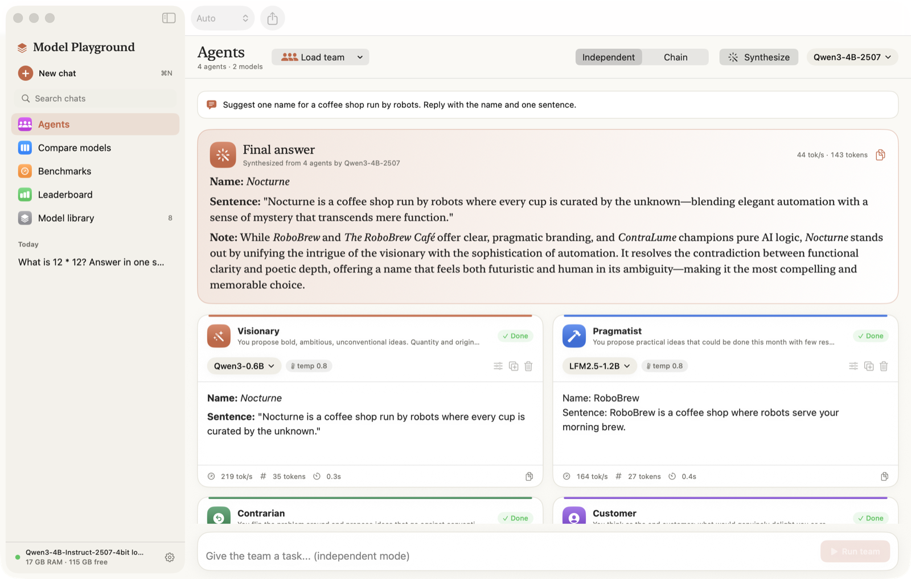 | 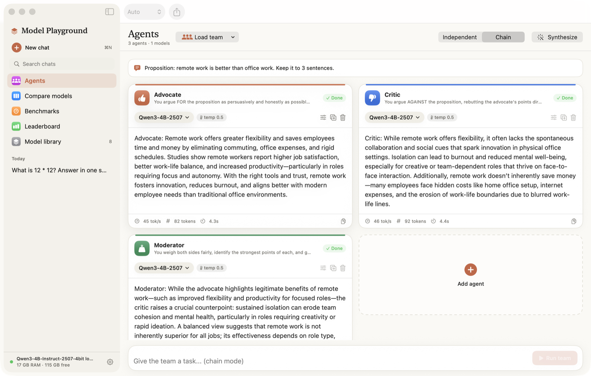 |

## AirLLM

AirLLM is available for every unquantized Llama-style model (TinyLlama, Llama 3.x, Mistral, SmolLM2, SOLAR, up to Llama 3.3 70B) and can be
picked for chats, comparisons and agents. Models that support both engines get an **MLX / AirLLM switch** in the message box, and Settings has a default-engine option. On this Mac it ran Llama 3.2 1B at 0.14–0.2 tok/s with under 2.2 GB of memory, against about
200 tok/s for the same size of model on MLX. AirLLM is useful when a model does not fit in memory at all; MLX is the default because it is
roughly 1,000× faster and supports long prompts (AirLLM caps prompts at 512 tokens).

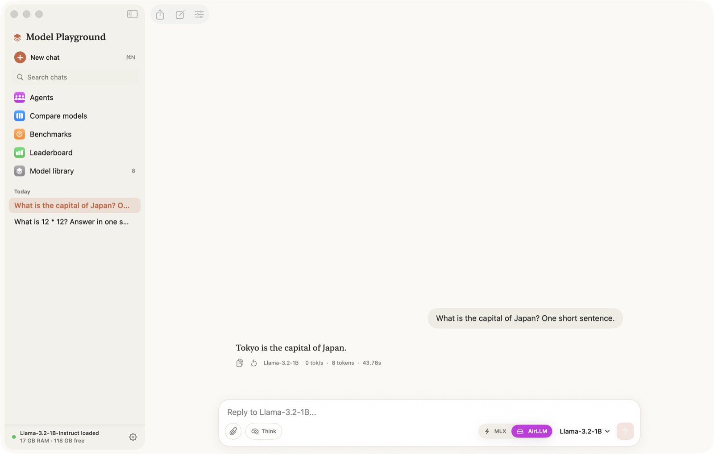

## Bugs found and fixed during testing

- **Qwen 3.5 reasoning was shown as the answer.** Its chat template opens `<think>` inside the prompt, so replies only contained the closing tag. The backend now emits the opening tag and the app folds reasoning correctly. Follow-up latency dropped from 26.5 s to 1.4 s because reasoning is no longer resent as history.
- **The judge returned 0/10 with long-thinking models.** The judge now runs with built-in thinking off (its prompt already asks for a reference answer first), and the parser ignores any reasoning before `</think>`.
- **Tiny judges rate everything 10/10.** Under about 4B parameters, judges failed to penalize a wrong answer (12×12 = 100). The app warns about this and defaults to the largest installed model; Qwen3-4B correctly marked down a factual error.
- **Download progress stuck at 0%.** Xet transfers buffer whole files before writing; downloads now use plain HTTP so progress is accurate.
- **"Reliable context" overstated results** when a shorter length failed; it now requires every shorter length to pass.
- **Compare looked broken with no models selected** (send button disabled with no explanation). It now pre-fills installed models and explains what's missing.
- **Dropped connections failed downloads.** A TLS reset aborted a download; downloads now retry up to 4 times and resume.
- **A self-test check rejected correct answers.** The bat-and-ball check flagged "110 cents" in worked steps; it now checks the first amount the answer states.
- **The message box disappeared off-screen.** When memory was low, the sidebar's warning text could wrap without limit, which raised the window's minimum height to 1,220 points (taller than a 14-inch MacBook's screen), so the window extended past the bottom. The warning now has fixed line limits, windows are pulled back onto the screen when they open, and a test forces the warning on and checks the window's minimum height (now 284 points).
- **Typing lagged while replies streamed.** See Speed above.
- **Replies could not be selected or copied.** The new Markdown renderer had no text selection; replies are now selectable, with a Copy button and a right-click menu.
- **Generated pages looked blank.** Pages that hide content until a scroll script runs stayed invisible when the reply was cut off; previews now reveal such content, the design prompt forbids it, and Studio pages get 8,000 tokens.
- **A leftover download server from testing ran for 4 days.** Stopped; it is not part of the app.
- **Streaming made Compare lag.** Every token re-rendered every column; updates are now batched to about 12 per second in chat, compare and agents.
- **AirLLM failed on Llama 3.2** (`load_npz` error). Models with tied embeddings have no `lm_head` weights, so AirLLM never wrote that shard; the engine now generates it from the embedding shard.
- **Sidebar selection used the system blue.** It now uses the app's own accent with hover states.
- **Port conflicts.** The engine now picks a free port on each launch and verifies it is talking to its own backend.

## Backend end-to-end

| | Check | Detail |
|---|---|---|
| ✅ | health identifies the app | {'ok': True, 'app': 'model-playground', 'version': '1.0.0', 'busy': False, 'loaded': None} |
| ✅ | catalog has 60+ models | 123 entries |
| ✅ | catalog entries have context sizes |  |
| ✅ | system info | {'total_ram_gb': 17.2, 'available_ram_gb': 2.9, 'swap_used_gb': 24.2, 'memory_percent': 83.0, 'free_disk_gb': 97.9} |
| ✅ | downloads finish | mlx-community/Qwen3-0.6B-4bit=done ; mlx-community/LFM2.5-1.2B-Instruct-4bit=done  |
| ✅ | download progress reaches total |  |
| ✅ | downloaded models are listed | NickMystic/WEBGEN-4B-Preview-mlx-6Bit, Qwen/Qwen2.5-0.5B-Instruct-mlx-4bit, khazarai/Qwen3.5-9B-Kimi-k3-Distilled-mlx-4bit, mlx-community/LFM2.5-1.2B-Instruct-4 |
| ✅ | hf cache models are listed |  |
| ✅ | chat Qwen3-0.6B-4bit streams an answer | '12 multiplied by 12 is 144.' |
| ✅ | chat Qwen3-0.6B-4bit reports stats | 235.71 tok/s, 14 tokens |
| ✅ | chat LFM2.5-1.2B-Instruct-4bit streams an answer | 'The result of 12 multiplied by 12 is 144.' |
| ✅ | chat LFM2.5-1.2B-Instruct-4bit reports stats | 41.14 tok/s, 14 tokens |
| ✅ | multi-turn context with 8-bit KV cache | "Hello! I'm Zorblat. If you have any questions or need help, feel free to ask! 😊" |
| ✅ | follow-up reuses the conversation cache | turn 2: 2306/2370 tokens cached, first token 0.10s vs 1.70s on turn 1 -> 'Priya Raman' |
| ✅ | preload loads a model ahead of time |  |
| ✅ | preloaded model is resident |  |
| ✅ | system reports memory pressure fields |  |
| ✅ | tokenize counts per model | {'/Users/amitprakash/ModelPlayground/models/mlx-community__Qwen3-0.6B-4bit': 201, '/Users/amitprakash/ModelPlayground/models/mlx-community__LFM2.5-1.2B-Instruct |
| ✅ | judge returns a score per answer | [{"accuracy": 10.0, "helpfulness": 10.0, "clarity": 10.0, "overall": 10.0, "verdict": "12 * 12 is 144.", "raw": "```json\n{\n  \"reference\": \"12 multiplied by |
| ✅ | judge scores are in range | a=10.0, b=10.0 |
| ✅ | eval grades the quiz | 6/13 passed |
| ✅ | eval runs the context test | 1K tokens, depth 50%=pass, 2K tokens, depth 50%=pass |
| ✅ | catalog has powerful 32GB+ models |  |
| ✅ | convert full-precision model to 4-bit MLX | 290 MB |
| ✅ | converted model is listed as quantized | Qwen2.5-0.5B-Instruct-mlx-4bit |
| ✅ | converted model answers | 'Paris' |
| ✅ | Llama 3.2 offers the AirLLM engine |  |
| ✅ | AirLLM runs Llama 3.2 | tied embeddings)  ('Tokyo is the capital of Japan.', 0.22 tok/s, peak 0.83 GB |
| ✅ | stop cancels generation | 6 tokens |
| ✅ | worker is idle after stop |  |
| ✅ | missing model returns 404 |  |
| ✅ | unload frees the model |  |
| ✅ | idle model is unloaded automatically |  |

## App self-test

| | Check | Detail |
|---|---|---|
| ✅ | engine starts on a free port | port 64897 |
| ✅ | catalog loads | 123 models |
| ✅ | installed models are found | LFM2.5-1.2B-Instruct-4bit, Llama-3.2-1B-Instruct, Qwen2.5-0.5B-Instruct-mlx-4bit, Qwen3-0.6B-4bit, Qwen3-4B-Instruct-2507-4bit, Qwen3.5-9B-4bit, Qwen3.5-9B-Kimi |
| ✅ | layout fits the screen | window minimum height)  (minimum 284 pt, window 840 pt, with the memory warning shown |
| ✅ | chat reply streams | 12 multiplied by 12 is 144. |
| ✅ | chat reply has stats | 231 tok/s, 14 tokens |
| ✅ | attachment is added |  |
| ✅ | model reads the attached file | PERIWINKLE |
| ✅ | regenerate replaces the last reply |  |
| ✅ | stop ends generation early | cancelled |
| ✅ | designer reply contains a page | 2798 characters of HTML |
| ✅ | canvas opens automatically |  |
| ✅ | canvas renders the page | 53 distinct colors in the preview |
| ✅ | edit puts the message back in the composer |  |
| ✅ | folder attach reads code and skips dependencies | README.md, src/app.py |
| ✅ | saved prompts persist |  |
| ✅ | chat runs on AirLLM | Llama-3.2-1B-Instruct: Tokyo is the capital of Japan.  · 0.22 tok/s, 1.2 GB |
| ✅ | compare runs every model | Qwen3-0.6B: 218 chars ; LFM2.5-1.2B: 202 chars ; Qwen3-4B-2507: 272 chars  |
| ✅ | compare collects stats |  |
| ✅ | tokenizer comparison counts prompt tokens | Qwen3-0.6B=15, LFM2.5-1.2B=15, Qwen3-4B-2507=15 |
| ✅ | judge scores every answer | 10.0, 10.0, 4.0 |
| ✅ | judge scores are in range |  |
| ✅ | vote is recorded |  |
| ✅ | blind mode hides model names | Model A, Model B, Model C |
| ✅ | voting reveals names |  |
| ✅ | team preset loads agents | Visionary, Pragmatist, Contrarian, Customer |
| ✅ | every agent answers in the grid  (**Elysia Coffee Bar** |  |
| ✅ | agents record stats |  |
| ✅ | synthesizer merges the answers  (**RoboBrew** |  |
| ✅ | progress reaches the end | 5/5 |
| ✅ | chain mode runs every agent in order | Advocate: Remote work off \| Critic: While remote work \| Moderator: The propositio |
| ✅ | benchmarks run for each model | LFM2.5-1.2B err=none; Qwen3-0.6B err=none |
| ✅ | quiz is graded | LFM2.5-1.2B 4/13, Qwen3-0.6B 6/13 |
| ✅ | context test covers lengths and depths | LFM2.5-1.2B 9/9, reliable to 4K, Qwen3-0.6B 8/9, reliable to - |
| ✅ | runs recorded for leaderboard | 21 runs |
| ✅ | judged quality reaches leaderboard |  |
| ✅ | chats persist to disk |  |

## Qwen3.5-9B in-app test

| | Check | Detail |
|---|---|---|
| ✅ | engine starts |  |
| ✅ | model is installed | Qwen3.5-9B-4bit, 5.98 GB, 256K context |
| ✅ | chat | no thinking)  (19.5 tok/s, 52 tokens, 1.63s first token, 5.2 GB \| A good API design prioritizes simplicity and consistency by using intuitive naming convention |
| ✅ | reasoning is folded into a thought block | thought 1405 words |
| ✅ | reasoning reaches a correct final answer | 19.7 tok/s, 2503 tokens, 1.01s first token, 5.4 GB \| The ball costs 5 cents. |
| ✅ | markdown table answer | 19.7 tok/s, 206 tokens, 1.41s first token, 5.5 GB \| \| Language \| Speed \| Safety \| Learning Curve \| \| :--- \| :--- \| :--- \| :--- \| \| **Python** \| Mod |
| ✅ | long document Q&A | 8-bit KV cache)  (prompt 5459 tokens · 19.4 tok/s, 86 tokens, 41.31s first token, 7.0 GB \| Based on the text provided in the file, the backup generator at the  |
| ✅ | compare Qwen3.5-9B is answered and judged | 21.4 tok/s, 143 tokens, judge 10.0/10 · The answer is accurate, helpful, clear, and well within the word limit. |
| ✅ | compare Qwen3-4B-2507 is answered and judged | 51.8 tok/s, 107 tokens, judge 10.0/10 · The answer is accurate, helpful, and clear. |

Benchmarks (from the full run with 32K contexts):

| | Check | Detail |
|---|---|---|
| ✅ | benchmark Qwen3.5-9B | quiz 11/13, context 18/18, reliable to 32K, 115 tok/s prompt processing at 32K, peak 9.6 GB |
| ✅ | benchmark Qwen3-4B-2507 | quiz 10/13, context 18/18, reliable to 32K, 125 tok/s prompt processing at 32K, peak 9.6 GB |

## Screenshots

Captured by the self-test from the running app.

| | |
|---|---|
| 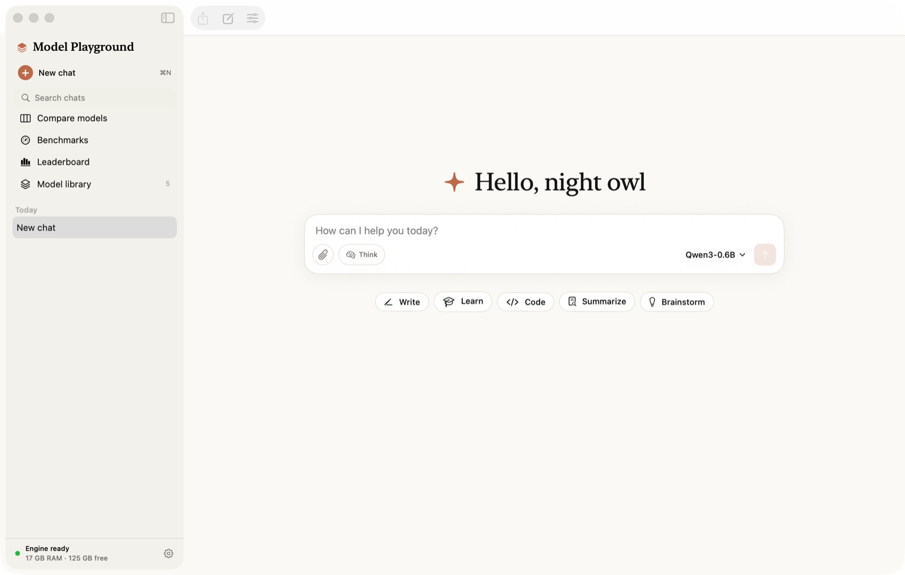 | 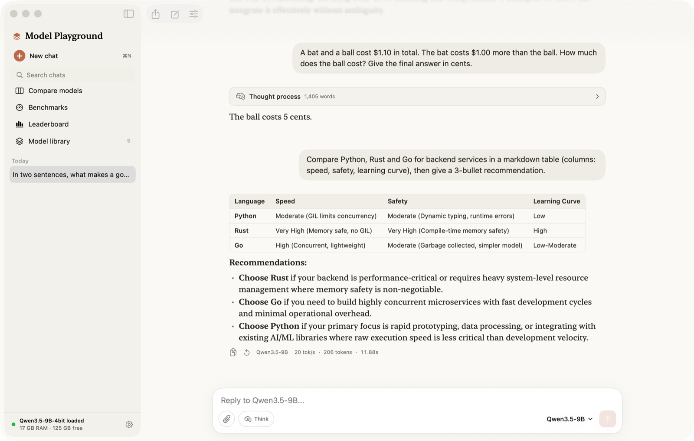 |
| Welcome | Chat with Qwen3.5-9B: folded reasoning, table, stats |
| 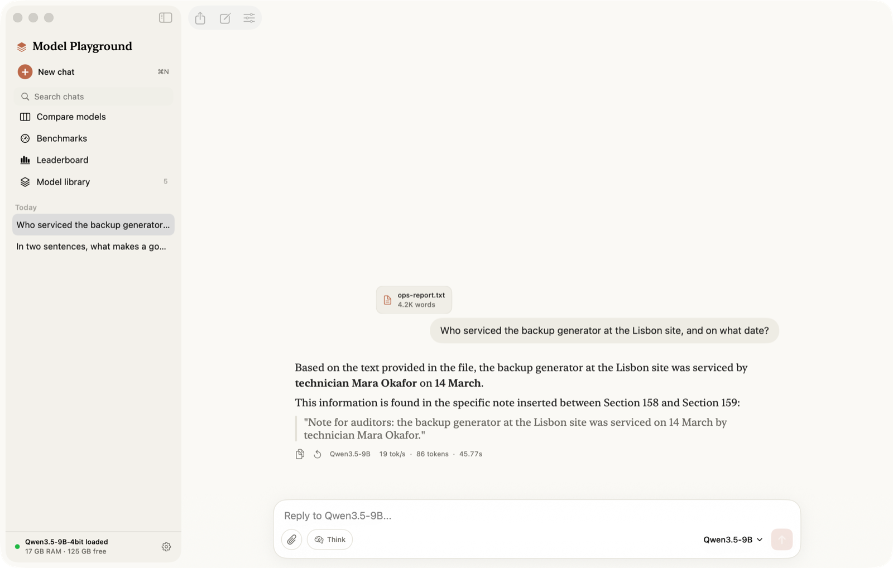 | 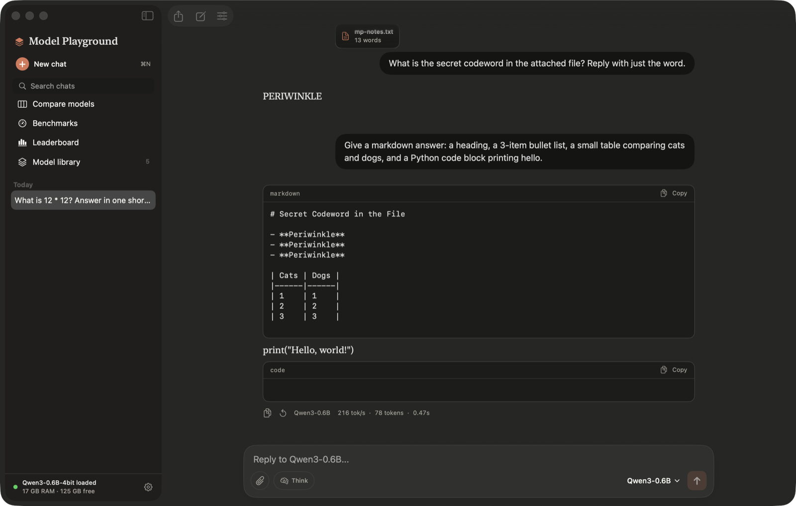 |
| Long document Q&A with an attachment | Dark mode |
| 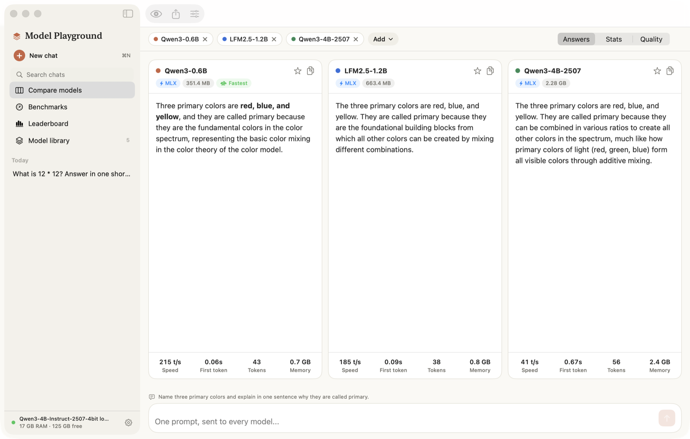 | 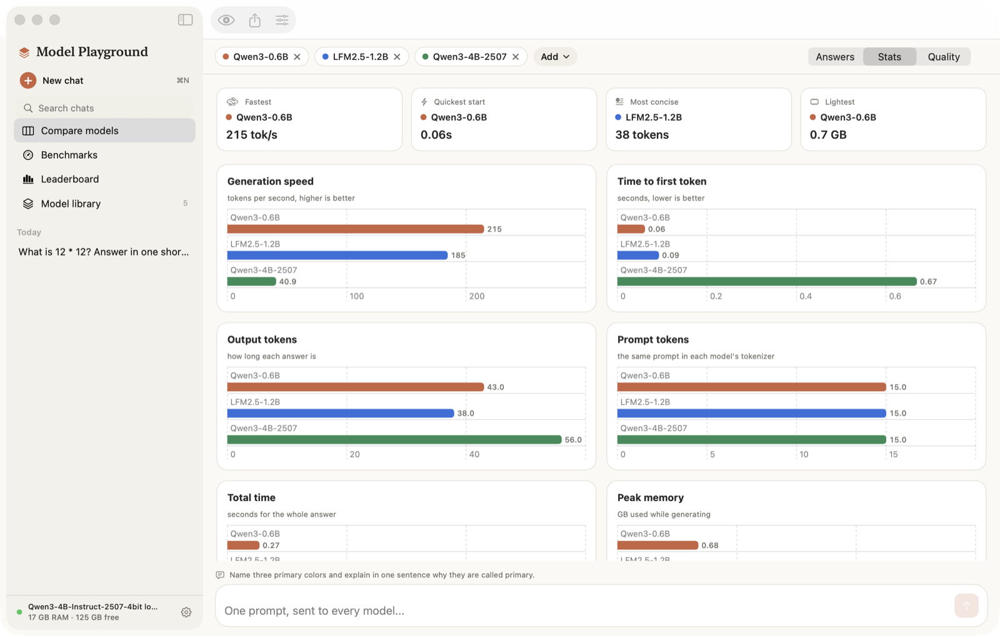 |
| Compare: answers | Compare: speed and token charts |
| 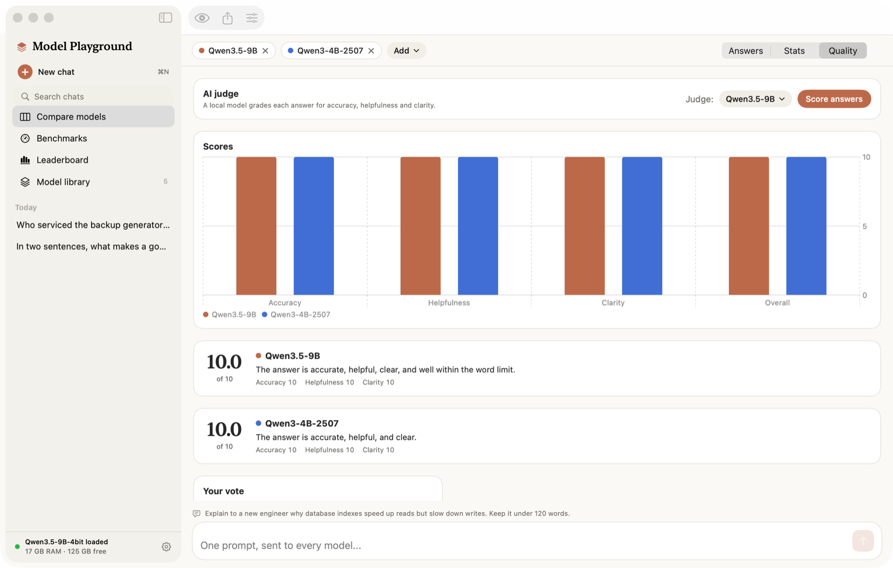 | 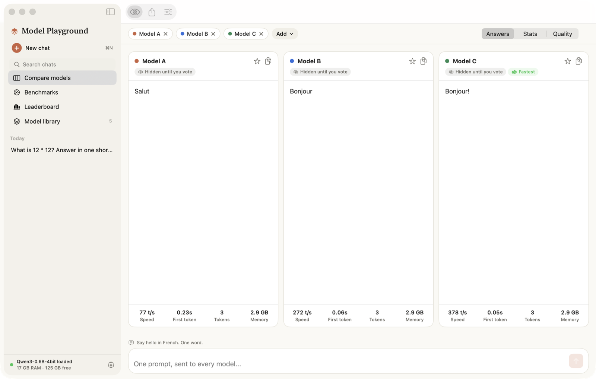 |
| Compare: AI judge | Blind arena |
| 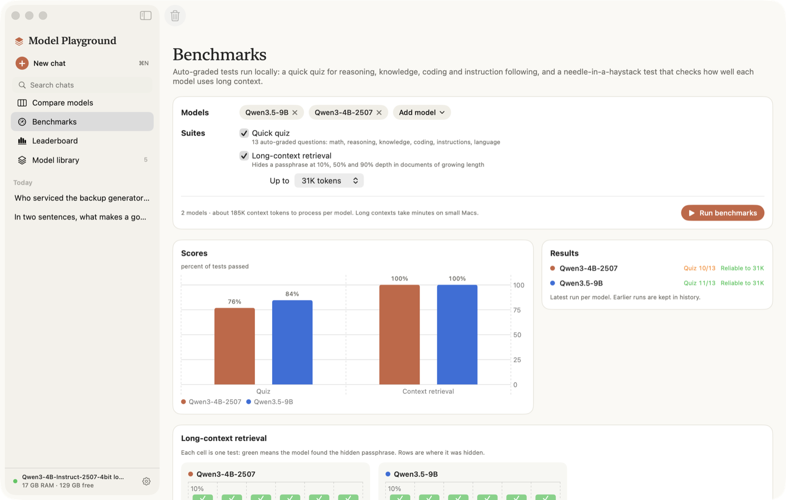 | 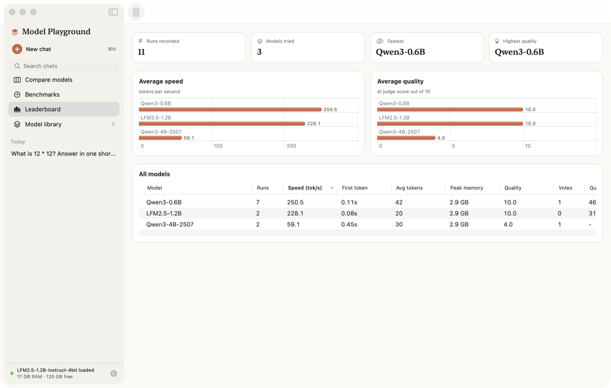 |
| Benchmarks: Qwen3.5-9B vs Qwen3-4B to 32K | Leaderboard |
| 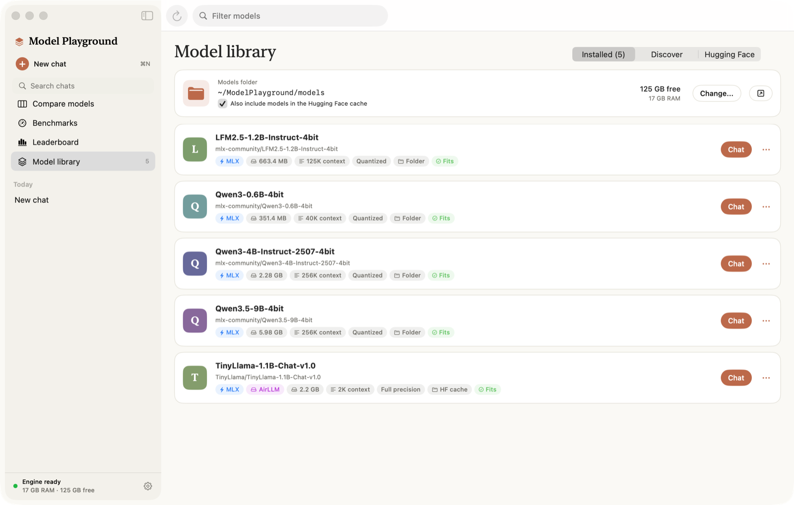 | |
| Model library | |
